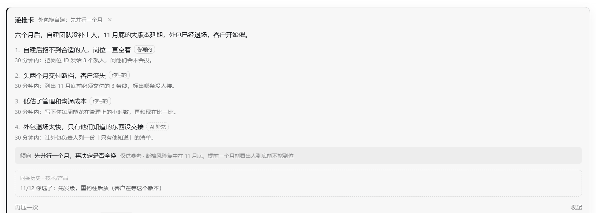

# 逆推 · nitui

> 假设六个月后已经失败，再倒过来找死因。三个问题、两分钟，一张验尸卡。

nitui 是 [DeepSeek Harness](https://github.com/deepseek-ai) 的插件。它不替你做决定，只做一件事：在真正拍板之前，先假设这个决定已经失败，然后反向列出最可能的死因，并为每条死因配一个 **30 分钟内能做完** 的检验动作。

- **明线**：三问 → 一张验尸卡。死因按可能性排序，标注「你写的 / AI 补充」，每条都带检验动作；倾向只作参考，不替你下结论。
- **暗线**：在本机记录你实际做过的取舍；同类取舍再次出现时，在对话底部提示三行旧账，提醒你上次是怎么选的。
- **只在本机**：记录写在本地 JSONL，不上传、不遥测；插件本身不发起外部网络请求。



## 是什么

### 明线：事前验尸

1. ① 最近有什么事让你犹豫？——一句话说清那个还没定下来的选择。
2. ② 假设六个月后这个决定失败了，最可能的原因是什么？——写一两条即可，也可以点模型给的参考再改成自己的话。
3. ③ 一个追问——由模型根据 ② 生成，逼你把某条失败原因说得更具体（时间、钱数、某个人的原话、能看到的现象）；可跳过。

出结果后是一张「逆推卡」：失败场景、3–5 条死因、每条死因下面的 30 分钟检验动作，以及一条仅供参考的倾向。模型不可用时不会卡住流程，卡片会降级为「只整理你写的内容」，并明确标注。

### 暗线：旧账

- 当对话里能看出「在几个选项之间做选择」时，准备一次召回；能看出「已经定了」时，记一条低置信度的选择。
- 召回有三道闸门：同一个域、同一个取舍方向、同域记录攒够阈值；任何一道不过都不提示。
- 每个域默认有词表，也可以自定义域和关键词；跨域永不召回。
- 设置里可以关闭记录与召回、调整门槛（严格 / 标准 / 积极）、查看「我记录了什么」、导出或清除记录。
- 模型也可以通过 `log_choice` / `recall_choice` 两个工具参与，但暗线不依赖模型：模型不配合时，关键词规则仍然工作。

## 怎么装

需要带插件系统的 DSH（`dsh web` 或 DSH Desktop）。

**从本地目录安装（开发时）**

```sh
dsh plugin --profile web add file:/path/to/nitui
```

Windows 示例：

```sh
dsh plugin --profile web add file:D:\shiqianyanshika\plugin
```

**从 npm 安装（发布后）**

```sh
dsh plugin --profile web add @zhangxij/dsh-nitui
```

> 包名已设为 `@zhangxij/dsh-nitui`。如果 fork 到别的 scope，要同步改三处：`package.json` 的 `name`、`cordis.patch.yml` 的 `name`、`client.js` 里 `__ModuleLoader__.load({ id })` 的 id，否则宿主会找不到浏览器半侧。
>
> 本地已经装过旧包名的，先在插件管理里移除旧条目，再按上面的命令重装。

安装后重启或刷新 DSH：

- 输入框左上方出现「压一下」按钮；
- 左侧栏出现「我的推演」入口；
- 在「压一下」卡片里点 ⚙ →「完整设置」，可以调暗线和版式。

具体参数以 `dsh plugin --help` 为准。

## 怎么用

1. 点输入框上方的「压一下」。
2. 依次回答三问；② 下面的三条候选只是帮你开口，点一下会填进输入框，改成自己的话即可。
3. 点「出结果」得到验尸卡；可以「收起」，也可以「再压一次」。
4. 在「我的推演」里按状态（全部 / 进行中 / 已完成 / 已取消）、域筛选和排序；支持继续、重命名、删除。
5. 暗线召回出现在对话底部；点「×」会在 7 天内不再提示这一类，点「查看全部记录」进入设置页。

## 数据在哪

数据目录按下面的顺序取，**取到第一个就用它**：

1. 插件配置 `config.dataRoot`（`cordis.patch.yml` 里的 `config.dataRoot`）；
2. 环境变量 `DSH_NITUI_DATA`；
3. 仓库内 `data/`——**仅开发时**：插件目录不在 `node_modules` 里，且 `data/` 已经存在（跑过 `node seed.js` 才会有）；
4. 用户目录 `~/.nitui`（Windows 上是 `C:\Users\<你的用户名>\.nitui`）。

任何一步解析到 `node_modules` 里，都会退回 `~/.nitui`。安装后的包不会往自己的安装目录写数据。

目录里是四个文件：

| 文件 | 内容 | 写入方式 |
| --- | --- | --- |
| `sessions.jsonl` | 三问推演的事件（start / answers / followup / done / cancel / delete / rename），列表由事件折叠而来 | 追加；删除是追加一条 delete 事件 |
| `choices.jsonl` | 暗线选择记录（log / delete） | 追加；删除是追加一条 delete 事件 |
| `recalls.jsonl` | 召回与静音记录（recall / mute） | 追加 |
| `config.json` | 暗线设置与版式 | 覆盖写 |

- 备份：关掉 DSH，直接复制整个数据目录。
- 清空：关掉 DSH，删除数据目录；或在设置页「清除全部」（只清 `choices.jsonl` 和 `recalls.jsonl`）。
- 导出：设置页的「导出 JSON」只导出暗线选择记录，不包含推演会话。
- 卸载插件不会删除数据目录，需要手动清理。

## 隐私与权限

- **不发起外部网络请求**：插件没有遥测、统计、字体、CDN 或第三方 API；浏览器端只 `fetch` 同源的 `/nitui/*`，并带上 DSH 的 `dsh-auth-*` 会话凭据。宿主先跑同源校验（`Origin` 与 `Host` 不一致直接 403），再调用 `ctx.connection.requestRejection` 做 DSH 访问检查：没有有效 DSH 凭据的请求返回 401，跨站请求返回 403，都在任何路由逻辑之前。
- **模型请求**：生成 ② 的候选、③ 的追问和验尸卡时，会把你在三问里写的内容通过 DSH 的 `llm` 服务发给你当前配置的模型提供方。不会发送历史记录或暗线记录；请求由宿主发出，插件不直连任何模型 API。
- **读取对话**：暗线开启时，会读取用户新消息的文本，用来判断「在取舍」还是「已经定了」；只把派生出的选择记录写到本机，不保存整条消息。
- **文件访问**：只读写上面的数据目录；不扫描其它目录，不写 `node_modules`。
- **HTTP 面**：只注册同源路由 `GET /nitui/state`、`POST /nitui/action`、`GET /nitui/choices`、`GET /nitui/recall`；每个请求都先过 DSH 访问检查（`ctx.connection.requestRejection`），未授权 401、不可信来源 403；请求体上限 64 KiB，只接受 `application/json`。
- **给模型的两个工具**：`log_choice`（记一条选择）和 `recall_choice`（只读召回），外加一段系统提示，要求模型只在用户已经选定时记录。
- **关闭**：设置里的「记录选择并在同类选择上召回」关掉后，暗线停止记录与召回；明线仍可单独使用。

## 已知限制

- **中文优先**：界面文案是中文；`locale/zh.json`、`locale/en.json` 目前只有插件市场用的标题和描述，界面本身没有做多语言。
- **暗线是启发式**：域判断靠关键词，取舍方向靠正则，是否「定了」也靠正则；会误判、漏判，也会把「只是比较」当成选择。阈值和静音只能缓解，不能根除。
- **依赖模型质量**：追问和 AI 补充死因的质量取决于当前模型；模型不可用时会降级，只整理你写的内容，不补充死因。
- **单机单用户**：没有账号、同步、协作；数据是明文 JSON，落盘不加密。
- **只追加，不压缩**：`sessions.jsonl` 和 `choices.jsonl` 会一直增长；删除是 tombstone，不会立刻缩小文件。
- **导出不完整**：目前只能导出暗线选择记录，推演会话没有导出功能。
- **开发时会切数据目录**：如果仓库内存在 `data/`，开发中的插件会优先用它而不是 `~/.nitui`。跑过 `seed.js` 后如果看不到原有记录，先检查这一点；删掉仓库内 `data/` 即可回到用户目录。

## 开发

```text
index.js          宿主端：数据目录、JSONL 读写、/nitui 路由、模型调用、两个工具
client.js         浏览器端：压一下按钮、三问卡片、验尸卡、召回条、我的推演、设置页
seed.js           本地演示数据（只写仓库内 data/ 或 --dir 指定的目录）
cordis.patch.yml  插件挂载与默认配置
locale/*.json     市场用的中英文标题与描述
icon.svg          插件图标
icon-512.png      市场用 512×512 图标
screenshots.json  市场截图清单
market/           市场条目模板（提交到 awesome-dsh-plugin 用）
docs/screenshots/ 截图目录与拍摄说明
```

常用命令：

```sh
node --check index.js
node --check client.js
node --check seed.js
npm run check

# 往仓库内 data/ 写一份演示数据（已存在则拒绝，需 --force）
node seed.js

# 写到临时目录，不碰仓库和用户目录
node seed.js --dir D:\tmp\nitui-demo --force

# 检查 npm 包会带哪些文件
npm pack --dry-run
```

本地联调时可以用环境变量把数据指到临时目录：

```powershell
$env:DSH_NITUI_DATA = 'D:\tmp\nitui-dev'
```

## 发布（维护者）

1. **包名**：已设为 `@zhangxij/dsh-nitui`。如果换 scope，同时同步 `cordis.patch.yml` 的 `name` 和 `client.js` 里 `__ModuleLoader__.load({ id })` 的 id。
2. **建仓库**：仓库地址已按 `https://github.com/zhang-1239/dsh-nitui` 写在 `repository` / `homepage` / `bugs` 里；需要先在 GitHub 上创建这个仓库。若实际地址不同，改这三处。
3. **发布**：`npm publish --access public`（`prepublishOnly` 会先跑语法检查）。
4. **上架市场**：市场条目用 GitHub 仓库 URL + npm 包名 `@zhangxij/dsh-nitui`，条目里给出中英文描述和图标；截图放到 `docs/screenshots/`（见该目录的 README）。

## English

**nitui** is a premortem plugin for DeepSeek Harness. Before you commit to a decision, assume it has already failed six months from now, then work backwards: three questions produce a card of ranked causes, each with a check you can finish in 30 minutes. A local "dark line" also records choices you actually made and resurfaces three lines of history when a similar trade-off appears again.

- **Install:** `dsh plugin --profile web add @zhangxij/dsh-nitui` (the local dev form is `... add file:/path/to/nitui`). If you publish under a different scope, update the package name in `package.json`, `cordis.patch.yml`, and the `__ModuleLoader__` id in `client.js` together.
- **Data:** `config.dataRoot` → `DSH_NITUI_DATA` → repo-local `data/` (development only, and only if it exists) → `~/.nitui`. Never `node_modules`. Sessions and choices are append-only JSONL; settings are `config.json`.
- **Privacy:** no outbound requests from the plugin, no telemetry. Model prompts (hints, follow-up, card) go through the host's configured LLM and contain only what you typed in the three questions. User messages are inspected for choice detection only while the dark line is on; full messages are not stored. The browser half calls only same-origin `/nitui/*` routes with DSH's session credential, and the host runs `ctx.connection.requestRejection` before any route logic (401 without a valid DSH credential, 403 for an untrusted origin).
- **Limitations:** Chinese-first UI; the dark line is keyword/regex heuristics and will misfire; quality depends on the configured model; local single-user plaintext JSON with no sync or encryption; append-only files with no compaction; choices-only export.

## License

[MIT](LICENSE) © 2026 zhang-1239
